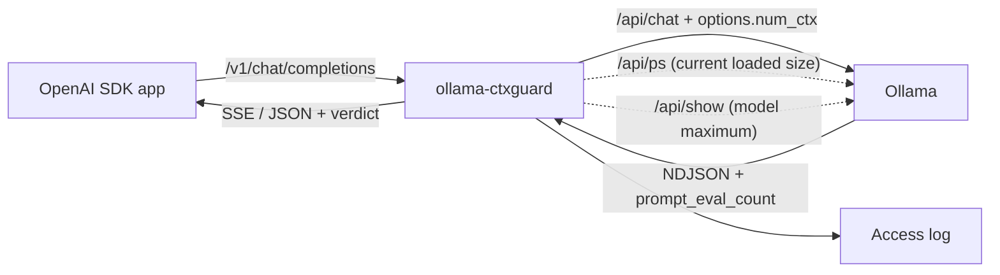

# ollama-ctxguard

**English** | [한국어](README.ko.md)

A small local proxy that sits in front of Ollama. Ollama's OpenAI-compatible `/v1/chat/completions` ignores the per-model context size (`num_ctx`) and, when the prompt is longer than the window, silently discards its beginning. ollama-ctxguard makes the `num_ctx` you configure actually apply, and flags every response whose prompt was cut by the context window. Built for people who point OpenAI SDK based agents, coding CLIs or RAG apps at a local Ollama; leave the app code as it is and change only `base_url`. Install: `dart pub get && mkdir -p build && dart compile exe bin/ollama_ctxguard.dart -o build/ollama-ctxguard`, then change your client's `base_url` to `http://127.0.0.1:11435/v1`.


*The `demo` output in practice mock mode. When the same request is sent directly to /v1, the model loads at 4096 and the beginning is cut; through ctxguard it loads at 16384 and the answer is right.*

## Who this is for

- People who attach agents, coding tools or RAG apps built with the OpenAI SDK to a local Ollama, and find that on long prompts the model forgets the system prompt or the beginning of a document
- People who, instead of creating a Modelfile alias per model or raising the server-wide `OLLAMA_CONTEXT_LENGTH`, want to set a per-model size with one line in a config file
- People who want to check at a glance how many tokens of window the model is actually loaded with right now

## Installation

Prerequisites: Dart SDK 3.8 or later ([installation guide](https://dart.dev/get-dart)), Git, and Ollama (needed only in real mode; not needed in practice mock mode). On a minimal Linux environment only basic tools like `git`, `curl` and `unzip` are needed (the build on Linux is verified by this repo's GitHub Actions).

```bash
git clone https://github.com/LeeGyeongPil/ollama-ctxguard
cd ollama-ctxguard
dart pub get
mkdir -p build
dart compile exe bin/ollama_ctxguard.dart -o build/ollama-ctxguard
```

`build/ollama-ctxguard` is the single executable (about 6.6MB). The `build` folder must be created before compiling. You can also do the same without installing, with `dart run bin/ollama_ctxguard.dart <command>`. The `ollama-ctxguard` in the examples below is `./build/ollama-ctxguard`.

> Installing with `dart pub global activate` and publishing to pub.dev are not prepared yet.

## Quick start

`demo` starts a fake Ollama inside the process and shows the problem and the fix in one go. It is **practice mock mode**, so no real model is used and no network is needed.

```bash
./build/ollama-ctxguard --lang en demo
```

If `LANG` is `ko_*`, a command without `--lang` prints Korean, so `--lang en` pins the screen below.

```text
ollama-ctxguard demo — practice mock: a fake Ollama runs in this process, no real model is used
prompt: 35495 bytes, "SECRET-CODE is 7731" at the very start; config: "qwen3:*": 16384

direct /v1    : num_ctx=4096 prompt_tokens=2050 verdict=truncated  answer: I don't see a secret code
via ctxguard  : num_ctx=16384 prompt_tokens=5520 verdict=ok  answer: 7731

what happened: /v1 ignored num_ctx, loaded the model at 4096 and silently kept only
2050 prompt tokens (about half of 4096), so the code at the start was lost.
ctxguard sent the same request to /api/chat with options.num_ctx=16384.

proxy log line (no prompt text is logged):
  {"ts":"2026-11-10T20:09:31.722969Z","method":"POST","path":"/v1/chat/completions","model":"qwen3:4b","stream":false,"status":200,"num_ctx":16384,"num_ctx_source":"config","prompt_tokens":5520,"est_prompt_tokens":5915,"verdict":"ok","ms":1}
```

(The `ts` time in the last log line differs on every run.)

How to read it: a long prompt with "SECRET-CODE is 7731" at the beginning was sent in two ways. Sent directly to `/v1`, the model loads with a 4096 window and keeps only about half of the prompt (2050 tokens), and the answer doesn't know the code. Through ctxguard, the same request is passed to native `/api/chat` with `options.num_ctx=16384` and it reads the code. The mock reproduces, as rules, the behavior real Ollama showed (prompt_tokens 2050 at 4096); in real mode the first request can take tens of seconds because of model loading.

### Attaching it to a real Ollama

```bash
cp example/ctxguard.yaml ./ctxguard.yaml      # edit the per-model num_ctx as needed
./build/ollama-ctxguard serve
```

Then change only the client's address: `base_url="http://127.0.0.1:11435/v1"` (Ollama's default is `11434`). The API key is only passed through and not logged.

```python
# Python (openai SDK)
client = OpenAI(base_url="http://127.0.0.1:11435/v1", api_key="ollama")
```

```ts
// Node.js (openai SDK)
const client = new OpenAI({ baseURL: "http://127.0.0.1:11435/v1", apiKey: "ollama" });
```

Ollama behind a reverse proxy with a path prefix, like `--upstream http://host/ollama`, is supported by `serve`, `doctor` and `demo` alike.

## Usage

| Command | What it does | Example |
|---|---|---|
| `serve` | Starts the proxy. Default `127.0.0.1:11435` → `http://127.0.0.1:11434` | `ollama-ctxguard serve --config ctxguard.yaml` |
| `doctor` | Compares the config value, model maximum, Modelfile value and currently loaded size in a table | `ollama-ctxguard doctor --model qwen3:4b --json` |
| `demo` | Runs the practice comparison above | `ollama-ctxguard demo` |
| `mock-upstream` | Starts a practice fake Ollama server | `ollama-ctxguard mock-upstream --port 11700` |

`serve` options: `--config` (default `./ctxguard.yaml`), `--upstream`, `--listen`, `--strict`, `--log-format json|text`, `--log-file`. Exit codes are 0 normal, 2 configuration error or upstream connection failure, 64 argument error.

### Screen language (English / Korean)

Help, `serve` start and warning lines, the `doctor` table and warnings, the `demo` explanation, `mock-upstream` notes and error messages come in English or Korean. The language is chosen in this order, and anything that is not Korean is English:

1. `--lang en|ko` (before or after the command)
2. the `OLLAMA_CTXGUARD_LANG` environment variable
3. `LC_ALL`, then `LC_MESSAGES`, then `LANG` (a value starting with `ko`, such as `ko_KR.UTF-8`, means Korean)

```bash
ollama-ctxguard --lang ko doctor
OLLAMA_CTXGUARD_LANG=ko ollama-ctxguard demo
```

These stay in English on purpose so scripts keep working: `doctor --json` (including `warnings`), the access log, HTTP response bodies and headers from the proxy, the `--version` output, exit codes, and the demo's prompt and raw log lines. Some text inside a localized sentence is also left as it is: the original message of the OS (for example `Failed to create server socket (Can't assign requested address)` after `error: cannot listen on …`), the YAML parser detail (for example `Expected node content.`), the original text of a command-line argument error the translation rules do not cover (it follows the prefix `인자 오류:` in Korean), and the demo's data labels (`num_ctx=`, `prompt_tokens=`, `verdict=`) and the model's answer sentence. If you compare human-readable text in a script, pin it with `--lang en` or `OLLAMA_CTXGUARD_LANG=en`.

### Scenario 1 — See the verdict in the response (non-streaming)

Start a fake Ollama in one terminal and the proxy in another (if a real Ollama is using 11434, change the mock's `--port`).

```bash
ollama-ctxguard mock-upstream --port 11700
ollama-ctxguard serve --config example/ctxguard.yaml --upstream http://127.0.0.1:11700 --listen 127.0.0.1:11735
curl -s -i http://127.0.0.1:11735/v1/chat/completions -H 'Content-Type: application/json' \
  -d '{"model":"qwen3:4b","messages":[{"role":"user","content":"Hello there"}]}'
```

Below is the response obtained by actually running the same setup (showing `"qwen3:*": 32768` from `example/ctxguard.yaml` being applied).

```text
HTTP/1.1 200 OK
X-Ctxguard-Num-Ctx-Source: config
content-length: 464
X-Ctxguard-Num-Ctx: 32768
X-Ctxguard-Verdict: ok
X-Ctxguard-Prompt-Tokens: 6
content-type: application/json; charset=utf-8
X-Ctxguard-Est-Prompt-Tokens: 1

{"id":"chatcmpl-866887384","object":"chat.completion","created":1794341373,"model":"qwen3:4b","system_fingerprint":"fp_ollama","choices":[{"index":0,"message":{"role":"assistant","content":"Hello from the practice mock (fake Ollama). I read 6 prompt tokens."},"finish_reason":"stop"}],"usage":{"prompt_tokens":6,"completion_tokens":12,"total_tokens":18},"ctxguard":{"verdict":"ok","num_ctx":32768,"prompt_tokens":6,"est_prompt_tokens":1,"num_ctx_source":"config"}}
```

- `X-Ctxguard-Num-Ctx: 32768`, `X-Ctxguard-Num-Ctx-Source: config` — means the value from the config was applied.
- `X-Ctxguard-Verdict: ok` — the truncation verdict. The same content is also in the `ctxguard` field at the end of the body.
- `X-Ctxguard-Prompt-Tokens` is the number of tokens Ollama actually read, and `...-Est-Prompt-Tokens` is the estimate the proxy counted from bytes (set conservatively low).

There are five verdicts: `ok` · `near_limit` (not enough room left to generate) · `suspect` (only traces of truncation) · `truncated` (judged as cut) · `unknown` (cannot tell). The values of `X-Ctxguard-Num-Ctx-Source` are `config` (the config), `request` (a value the request sent directly), `model_max` (the size Ollama reduced it to because the configured value was larger than the model maximum) and `ollama_ps` (the loaded size read from `/api/ps`).

### Scenario 2 — Streaming

If you send `"stream": true`, Ollama's line-by-line JSON is converted into OpenAI-style SSE and relayed piece by piece right away. In streaming the headers must go out first, so the verdict is carried not in a header but in the **`ctxguard` field of the last chunk**.

```bash
curl -s -N http://127.0.0.1:11735/v1/chat/completions -H 'Content-Type: application/json' \
  -d '{"model":"qwen3:4b","stream":true,"messages":[{"role":"user","content":"Hello there"}]}'
```

The last part (real output; the 12 word-by-word chunks before it are omitted):

```text
data: {"id":"chatcmpl-453081984","object":"chat.completion.chunk","created":1794341373,"model":"qwen3:4b","system_fingerprint":"fp_ollama","choices":[{"index":0,"delta":{},"finish_reason":"stop"}],"ctxguard":{"verdict":"ok","num_ctx":32768,"prompt_tokens":6,"est_prompt_tokens":1,"num_ctx_source":"config"}}

data: [DONE]
```

### Scenario 3 — Block truncated requests as errors with `--strict`

With `--strict`, a `truncated` verdict is turned into an error (422 for non-streaming; for streaming, an `error` chunk right before `[DONE]`). Below is the real response from sending a prompt that repeats `lorem ` 6000 times with the `"qwen3:*": 4096` setting (`--strict`, the proxy on a different port `11736`). To follow along, run the following with the mock upstream (`11700`) up.

```bash
printf 'models:\n  "qwen3:*": 4096\n' > strict.yaml
ollama-ctxguard serve --config strict.yaml --upstream http://127.0.0.1:11700 --listen 127.0.0.1:11736 --strict --log-format text
# in another terminal
python3 -c 'import json; print(json.dumps({"model":"qwen3:4b","messages":[{"role":"user","content":"lorem "*6000}]}))' > big.json
curl -si http://127.0.0.1:11736/v1/chat/completions -H 'content-type: application/json' -d @big.json
```

```text
HTTP/1.1 422 Unprocessable Entity
X-Ctxguard-Reason: context_shift_signature
X-Ctxguard-Num-Ctx-Source: config
content-length: 252
X-Ctxguard-Num-Ctx: 4096
X-Ctxguard-Verdict: truncated
X-Ctxguard-Prompt-Tokens: 2050
content-type: application/json; charset=utf-8
X-Ctxguard-Est-Prompt-Tokens: 6000

{"error":{"message":"prompt appears truncated by the Ollama context window (num_ctx=4096, prompt_tokens=2050, est_prompt_tokens=6000). Raise num_ctx for this model in ctxguard.yaml.","type":"context_truncated","param":null,"code":"ctxguard_truncated"}}
```

`suspect`, `near_limit` and `unknown` are not blocked even with `--strict`. These three are verdicts without confidence, so blocking could make legitimate requests fail.

### Scenario 4 — Check the current state with `doctor`

```bash
ollama-ctxguard --lang en doctor --upstream http://127.0.0.1:11700 --config example/ctxguard.yaml
```


*The `doctor` output. This is how it looks after one direct request to /v1 on the mock made it load at 4096.*

Transcribed as text, it is as follows (mock, same situation).

```text
Ollama 0.0.0-practice-mock at http://127.0.0.1:11700
MODEL        CONFIG  MODEL MAX  MODELFILE  LOADED      /v1 DIRECT
qwen3:4b     32768   40960      -          4096        4096*
llama3.2:3b  16384   40960      -          not loaded  server default
* guessed from the current load: a /v1 client gets the server default
  (OLLAMA_CONTEXT_LENGTH or a VRAM-based default) unless the Modelfile sets num_ctx
warning: qwen3:4b: loaded at 4096 but config says 32768 — the next request through ctxguard reloads it
```

- The `/v1 DIRECT` column is "the size you would get if you connected to /v1 without ctxguard." Ollama has no API that reports the server default, so if the Modelfile has no `num_ctx`, it is **estimated from the currently loaded size** and marked with `*`. It may be wrong.
- The last `warning` means "the config says 32768 but it is currently loaded at 4096, so the model is reloaded on the next request."
- If it cannot connect to Ollama, it ends with an error and exit code 2.

```text
error: cannot reach Ollama at http://127.0.0.1:1 (is it running? set --upstream)
```

### Reading the access log

`serve` writes one line per request to stderr (to a file with `--log-file`, in a human-friendly format with `--log-format text`). It does not record the prompt, the response body or `Authorization`, and leaves only fixed fields. Below is the real log obtained from the scenarios above.

```text
ollama-ctxguard 0.2.0 listening on http://127.0.0.1:11735 -> upstream http://127.0.0.1:11700 (2 model rules, strict=false)
{"ts":"2026-11-10T20:09:33.777875Z","method":"POST","path":"/v1/chat/completions","model":"qwen3:4b","stream":false,"status":200,"num_ctx":32768,"num_ctx_source":"config","prompt_tokens":6,"est_prompt_tokens":1,"verdict":"ok","ms":1}
{"ts":"2026-11-10T20:09:33.796980Z","method":"POST","path":"/v1/chat/completions","model":"qwen3:4b","stream":true,"status":200,"num_ctx":32768,"num_ctx_source":"config","prompt_tokens":6,"est_prompt_tokens":1,"verdict":"ok","ms":1}
{"ts":"2026-11-10T20:09:33.840871Z","method":"POST","path":"/v1/chat/completions","status":403,"ms":0,"event":"host_not_allowed"}
{"ts":"2026-11-10T20:09:33.851702Z","method":"POST","path":"/v1/chat/completions","model":"qwen3:4b","stream":false,"status":403,"est_prompt_tokens":0,"ms":0,"event":"origin_rejected"}
shutting down
```

```text
ollama-ctxguard 0.2.0 listening on http://127.0.0.1:11736 -> upstream http://127.0.0.1:11700 (1 model rules, strict=true)
2026-11-10T20:10:25.256384Z WARN method=POST path=/v1/chat/completions model=qwen3:4b stream=false status=422 num_ctx=4096 num_ctx_source=config prompt_tokens=2050 est_prompt_tokens=6000 verdict=truncated reason=context_shift_signature ms=4 event=ctx_warning
shutting down
```

If the verdict is not `ok`, `event=ctx_warning` is added. The other `event` values are `host_not_allowed` (a Host that is not allowed, 403) and `origin_rejected` (Ollama rejected the browser Origin, 403). In both cases the Host and Origin values sent by an attacker are not written to the log. In the text format, values containing spaces, `=` or quotes are wrapped in quotes, as in `model="x verdict=ok"`, so that fake fields can't be created.

## Configuration

Copy `example/ctxguard.yaml` and use it. `serve` and `doctor` read `ctxguard.yaml` in the current folder if there is no `--config`, and command-line options take precedence over the config file.

| Key | Default | Description |
|---|---|---|
| `upstream` | `http://127.0.0.1:11434` | Ollama address |
| `listen` | `127.0.0.1:11435` | Address the proxy listens on. By default it can be reached only from my own computer |
| `models` | none | Model name (`*` and `?` globs allowed) → `num_ctx`. Exact name > more specific glob > less specific glob. A name without a tag means `:latest` |
| `default` | none | The value to give models not in the list. If absent, the server default is left as is |
| `strict` | `false` | Turn a `truncated` verdict into an error |
| `truncation.*` | `keep_slack 8`, `bytes_per_token 6`, `ratio 1.2`, `reserve 512` | Verdict tuning values (normally leave as is) |
| `upstream_timeout_seconds` | `600` | Maximum time to wait for response headers |
| `log_format`, `log_file` | `json`, stderr | Access log format and file (rotated to `.1` when over 10MB) |

If you change the value for the same model often, Ollama reloads the model (slower), so one value per model is recommended. If the configured value exceeds the model's maximum context, Ollama cuts it to the maximum, so check the `doctor` warning (the `serve` verdict is also made reduced to the model maximum, and its source is `model_max`). No API key or `.env` is needed.

The defaults are on the safe side. There is no authentication, so if you open it on a non-loopback address such as `0.0.0.0`, it prints a one-line warning at startup. Anyone on the same network can then use your local model, so open it only when truly necessary.

While it is open on loopback, requests whose Host is not `localhost`, this PC's name, `*.localhost` or a private IP are rejected with 403 (`host_not_allowed`) (DNS rebinding protection, the same rule as Ollama). The browser's `Origin` header is passed to Ollama as is, so the `OLLAMA_ORIGINS` setting applies identically through the proxy. A local web app with an allowed Origin receives the CORS headers. When rejected, guidance about `OLLAMA_ORIGINS` is included in the error message.

```text
$ curl -s -i http://127.0.0.1:11735/v1/chat/completions -H 'Host: evil.example:11735' -H 'Content-Type: application/json' -d '{"model":"qwen3:4b","messages":[{"role":"user","content":"hi"}]}'
HTTP/1.1 403 Forbidden
content-type: application/json; charset=utf-8
content-length: 224

{"error":{"message":"host not allowed: ctxguard only answers requests addressed to localhost or this machine (DNS rebinding protection, same rule as Ollama)","type":"permission_error","param":null,"code":"host_not_allowed"}}
```

## How it works

The priority by which `num_ctx` is determined (per Ollama's docs) is the request's `options.num_ctx` > the Modelfile's `PARAMETER num_ctx` > the server's `OLLAMA_CONTEXT_LENGTH` > a VRAM-based default. But `/v1/chat/completions` has no place to carry the request value, so the first item drops out. As of 2026-11-11 this was checked directly on Ollama 0.40.15, and the 0.40.16 release notes say only `/v1/responses` was fixed, so `/v1/chat/completions` is assumed to still ignore it ([release notes](https://github.com/ollama/ollama/releases), [OpenAI compatibility](https://docs.ollama.com/api/openai-compatibility)). To check whether it is needed on the Ollama version you use, use `dart run tool/real_ollama_check.dart`, not the mock of `ollama-ctxguard demo`.



1. The app calls `/v1/chat/completions` in OpenAI format as usual. Ollama's `/v1` doesn't accept `num_ctx`, so it loads the model at the server default size (measured: 4096).
2. The proxy converts the request to native `/api/chat` format and puts the config's `num_ctx` into `options.num_ctx` (it also converts `max_tokens`→`num_predict`, `response_format`→`format`, `reasoning_effort`→`think` and so on). For native `/api/chat` and `/api/generate` it fills in the config value only when `options.num_ctx` is empty, and passes all other paths through byte for byte.
3. It converts Ollama's line-by-line response back to OpenAI format (JSON or SSE). Streaming is relayed as soon as it is received, and when the client drops the connection, the request to Ollama is cancelled right away too.
4. Truncation verdict: when a prompt is longer than `num_ctx`, Ollama keeps only the first few tokens and discards the front part, reading only about half of `num_ctx` (measured: 4096 → 2050, 2048 → 1026). If the response's `prompt_eval_count` is near that half, and the estimated input the proxy counted in bytes is 1.2 times or more larger than it, it is judged `truncated`.
5. If the `num_ctx` in the config or request is larger than the model maximum (`context_length` from `/api/show`), Ollama reduces it to the maximum, so the proxy also judges with the smaller of the two (source `model_max`). The `X-Ctxguard-Num-Ctx` header in streaming may also be the reduced value.
6. For when the actually applied size is unknown, after a response it reads the loaded size from `/api/ps` and caches it per model for 30 seconds.

## Limitations

- **The verdict is an estimate.** Because of template tokens, images and per-language byte/token ratios, `suspect` and `near_limit` can be wrong. The version verified against a real server is only Ollama 0.40.15.
- **The Origin check follows Ollama's settings.** If you opened it with `OLLAMA_ORIGINS=*`, the proxy also lets that Origin through.
- **If `/api/show` can't be read, the model-maximum correction is skipped.** If the lookup fails, as behind a reverse proxy that requires authentication, it judges with the config value as is.
- **Without a signal it is `unknown`.** If the response has no `prompt_eval_count`, or it is 0, negative or not a number, or the applied `num_ctx` can't be known, or the value exceeds `num_ctx`, or the stream is cut off without an end marker (`done`), it doesn't say `ok` and emits `unknown` with a reason code (a warning log is also left). However, `unknown` is **not blocked** even under `--strict`. That is, if the signal disappears, it may fail to block even when truncation exists.
- **Non-streaming requests run to completion even if the client disconnects.** Client disconnects are detected only for streaming and pass-through responses, which cancels the upstream. A non-streaming request that Ollama is already generating a response for continues until generation ends even after the client leaves.
- Streaming and pass-through responses close the connection when finished (no keep-alive reuse).
- `/v1/completions` and `/v1/embeddings` are only passed through and `num_ctx` is not applied (`num_ctx_not_applied` in the log).
- There is no authentication or TLS. By default it is loopback only.
- Local verification was done on macOS arm64 with Dart 3.8.1, and Linux is verified by CI.

## When to use it

- When it fits: when you use Ollama through an OpenAI-compatible client and want to set the per-model context size without code changes and learn about truncation directly from the response.
- Proxies with a similar purpose include general-purpose gateways such as [ollama-proxy-rs](https://docs.rs/crate/ollama-proxy-rs/latest) and [LiteLLM](https://docs.litellm.ai/docs/providers/ollama). This tool is a small single executable that only applies `num_ctx` and flags truncation; if you need authentication or distributing across several servers, those fit better (check each tool's features in its official documentation).
- When another approach is better: if you use only one model, the Modelfile's `PARAMETER num_ctx` may be enough, and if you use all models at the same size, the server's `OLLAMA_CONTEXT_LENGTH` ([Context length](https://docs.ollama.com/context-length)) may be enough. If you can edit the app directly, there is also the option of sending `options.num_ctx` of native `/api/chat` directly.

## Troubleshooting

| Symptom | Cause | Fix |
|---|---|---|
| `cannot listen on 127.0.0.1:11434 … try --port` (mock) | A real Ollama is already using 11434 | Use another port, as in `mock-upstream --port 11700` |
| `error: cannot reach Ollama at …` (exit code 2) | Ollama is off or the `--upstream` address is wrong | Check that Ollama is running, specify `--upstream` |
| `error: cannot listen on 127.0.0.1:11435: port already in use …` | Another ctxguard is still running or the port is in use | `--listen 127.0.0.1:<another port>` |
| `error: Could not find a command named "frob".` followed by the usage (exit code 64) | The command name is misspelled | Pick one of `serve`, `doctor`, `demo`, `mock-upstream` from the usage. With `--lang ko` the line is `오류: 알 수 없는 하위 명령입니다: "frob"` |
| 403 `host_not_allowed` | The request's Host is not localhost, this PC's name or a private IP | Change the address to `127.0.0.1` or `localhost` |
| 403 `upstream returned HTTP 403 … Origin` | Ollama rejected the browser Origin | Allow it on the Ollama server with `OLLAMA_ORIGINS` |
| `dart compile exe` gives an output folder error | The `build` folder doesn't exist | Run `mkdir -p build` and compile again |
| The verdict stays `unknown` | The Ollama response has no `prompt_eval_count` or the applied size is unknown | Check the `reason` in the log, check the model and loaded size with `doctor` |
| It gets slow every time the model changes | A different `num_ctx` comes in for the same model and Ollama reloads it | Use only one value per model, and if the native `num_ctx` the client sends differs from the config, check `num_ctx_request_override` in the log |
| The first request takes tens of seconds | Model loading in real mode (longer for a large `num_ctx`) | Normal. The time limit is `upstream_timeout_seconds` |
| The `/v1 DIRECT` value in `doctor` looks odd | With no Modelfile value, it is estimated from the currently loaded size | See the `*` footnote; it is an estimate |

## Development and contributing

```bash
dart pub get
dart format --output=none --set-exit-if-changed .
dart analyze --fatal-infos
dart test
```

All 145 tests of `dart test` pass (about 2 seconds, run only inside 127.0.0.1 with a fake Ollama, no real Ollama or external network needed). The optional tool for checking the behavior against a real Ollama is `dart run tool/real_ollama_check.dart`.

Please leave bugs and suggestions as issues. For the change log, see [CHANGELOG.md](CHANGELOG.md).

## Further reading

- Ollama official docs: [Context length](https://docs.ollama.com/context-length), [OpenAI compatibility](https://docs.ollama.com/api/openai-compatibility) (checked 2026-11-11)
- An article on the same symptom: [Ollama num_ctx silent prompt truncation](https://particula.tech/blog/ollama-num-ctx-silent-prompt-truncation) (checked 2026-11-11)

## License

MIT. The practice mock mode uses no external models or data. The licenses of the models used in real mode follow each model.
