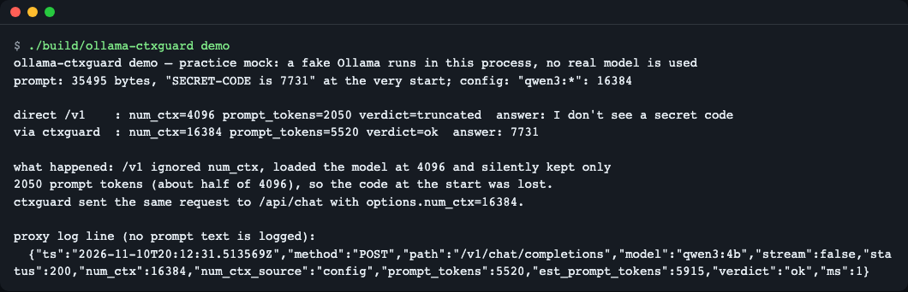
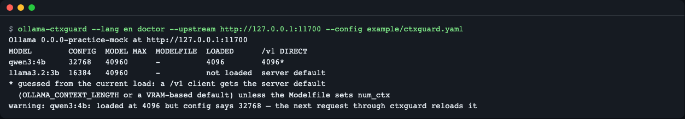
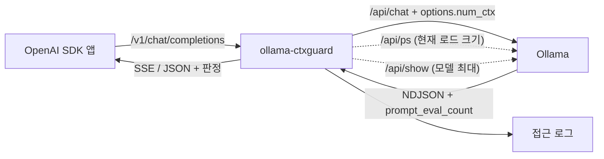

# ollama-ctxguard

**한국어** | [English](README.en.md)

> **English summary** — A small local proxy that sits in front of Ollama. It makes the per-model context size (`num_ctx`) you configure actually apply to OpenAI-compatible `/v1/chat/completions` requests (which ignore it), and it flags responses whose prompt was silently cut by the context window. Built for people who point OpenAI SDK based agents, coding CLIs or RAG apps at a local Ollama. Install: `dart pub get && mkdir -p build && dart compile exe bin/ollama_ctxguard.dart -o build/ollama-ctxguard`, then change your client's `base_url` to `http://127.0.0.1:11435/v1`.

Ollama 의 OpenAI 호환 주소(`/v1`)는 `num_ctx`(컨텍스트 창 크기)를 어디에 적어 보내도 무시하고, 프롬프트가 창보다 길면 앞부분을 **아무 표시 없이** 버립니다. `ollama-ctxguard` 는 앱과 Ollama 사이에 끼는 작은 프록시입니다. 앱 코드는 그대로 두고 `base_url` 만 바꾸면 모델별 `num_ctx` 가 실제로 적용되고, 잘림이 의심되면 응답마다 표시됩니다.


*연습용 목(mock) 모드의 `demo` 출력. 같은 요청을 /v1 로 직접 보내면 4096 으로 올라가 앞부분이 잘리고, ctxguard 를 거치면 16384 로 올라가 답이 맞습니다.*

## 이런 분께

- 로컬 Ollama 에 OpenAI SDK 로 만든 에이전트·코딩 도구·RAG 앱을 붙여 쓰는데, 긴 프롬프트에서 모델이 시스템 프롬프트나 문서 앞부분을 잊는 분
- 모델마다 Modelfile 별칭을 만들거나 서버 전체 `OLLAMA_CONTEXT_LENGTH` 를 올리는 대신, 설정 파일 한 줄로 모델별 크기를 정하고 싶은 분
- 지금 모델이 실제로 몇 토큰 창으로 올라가 있는지 한 번에 확인하고 싶은 분

## 설치

전제: Dart SDK 3.8 이상([설치 안내](https://dart.dev/get-dart)), Git, 그리고 Ollama(실제 모드에서만 필요. 연습용 목 모드는 필요 없음). 리눅스 최소 환경에서는 `git`·`curl`·`unzip` 같은 기본 도구만 있으면 됩니다(Linux 에서의 빌드는 이 레포의 GitHub Actions 로 확인합니다).

```bash
git clone https://github.com/LeeGyeongPil/ollama-ctxguard
cd ollama-ctxguard
dart pub get
mkdir -p build
dart compile exe bin/ollama_ctxguard.dart -o build/ollama-ctxguard
```

`build/ollama-ctxguard` 가 단일 실행 파일입니다(약 6.6MB). `build` 폴더는 컴파일 전에 만들어 두어야 합니다. 설치 없이 `dart run bin/ollama_ctxguard.dart <명령>` 으로도 같은 일을 할 수 있습니다. 아래 예의 `ollama-ctxguard` 는 `./build/ollama-ctxguard` 입니다.

> `dart pub global activate` 로 설치하는 방법과 pub.dev 게시는 아직 준비하지 않았습니다.

## 빠르게 시작하기

가짜 Ollama 를 프로세스 안에 띄워 문제와 해결을 한 번에 보여 주는 `demo` 입니다. **연습용 목(mock) 모드**라서 실제 모델은 쓰지 않고 네트워크도 필요 없습니다.

```bash
./build/ollama-ctxguard demo
```

```text
ollama-ctxguard demo — practice mock: a fake Ollama runs in this process, no real model is used
prompt: 35495 bytes, "SECRET-CODE is 7731" at the very start; config: "qwen3:*": 16384

direct /v1    : num_ctx=4096 prompt_tokens=2050 verdict=truncated  answer: I don't see a secret code
via ctxguard  : num_ctx=16384 prompt_tokens=5520 verdict=ok  answer: 7731

what happened: /v1 ignored num_ctx, loaded the model at 4096 and silently kept only
2050 prompt tokens (about half of 4096), so the code at the start was lost.
ctxguard sent the same request to /api/chat with options.num_ctx=16384.

proxy log line (no prompt text is logged):
  {"ts":"2026-11-10T20:09:31.722969Z","method":"POST","path":"/v1/chat/completions","model":"qwen3:4b","stream":false,"status":200,"num_ctx":16384,"num_ctx_source":"config","prompt_tokens":5520,"est_prompt_tokens":5915,"verdict":"ok","ms":1}
```

(맨 아래 로그 줄의 `ts` 시각은 실행할 때마다 다릅니다.)

읽는 법: 앞부분에 "SECRET-CODE is 7731" 을 넣은 긴 프롬프트를 두 방법으로 보냈습니다. `/v1` 로 직접 보내면 모델이 4096 창으로 올라가 프롬프트를 절반쯤(2050 토큰)만 남겼고 답은 코드를 모릅니다. ctxguard 를 거치면 같은 요청이 네이티브 `/api/chat` 에 `options.num_ctx=16384` 로 전달되어 코드를 읽습니다. 목은 실제 Ollama 가 보인 동작(4096 에서 prompt_tokens 2050)을 규칙으로 재현한 것이고, 실제 모드는 모델 로드 때문에 첫 요청이 수십 초 걸릴 수 있습니다.

### 실제 Ollama 에 붙이기

```bash
cp example/ctxguard.yaml ./ctxguard.yaml      # 모델별 num_ctx 를 필요에 맞게 고칩니다
./build/ollama-ctxguard serve
```

그리고 클라이언트의 주소만 바꿉니다: `base_url="http://127.0.0.1:11435/v1"` (Ollama 기본은 `11434`). API 키는 그대로 전달만 하고 로그에 남기지 않습니다.

```python
# Python (openai SDK)
client = OpenAI(base_url="http://127.0.0.1:11435/v1", api_key="ollama")
```

```ts
// Node.js (openai SDK)
const client = new OpenAI({ baseURL: "http://127.0.0.1:11435/v1", apiKey: "ollama" });
```

`--upstream http://host/ollama` 처럼 경로 접두가 있는 역프록시 뒤의 Ollama 도 `serve`·`doctor`·`demo` 모두 지원합니다.

## 사용법

| 명령 | 하는 일 | 예 |
|---|---|---|
| `serve` | 프록시를 띄웁니다. 기본 `127.0.0.1:11435` → `http://127.0.0.1:11434` | `ollama-ctxguard serve --config ctxguard.yaml` |
| `doctor` | 설정값·모델 최대·Modelfile 값·현재 로드 크기를 표로 비교합니다 | `ollama-ctxguard doctor --model qwen3:4b --json` |
| `demo` | 위의 연습용 비교를 실행합니다 | `ollama-ctxguard demo` |
| `mock-upstream` | 연습용 가짜 Ollama 서버를 띄웁니다 | `ollama-ctxguard mock-upstream --port 11700` |

`serve` 옵션: `--config`(기본 `./ctxguard.yaml`), `--upstream`, `--listen`, `--strict`, `--log-format json|text`, `--log-file`. 종료 코드는 0 정상, 2 설정 오류·업스트림 연결 실패, 64 인자 오류입니다.

### 시나리오 1 — 응답에서 판정 보기 (비스트리밍)

터미널 하나에서 가짜 Ollama 를, 다른 하나에서 프록시를 띄웁니다(실제 Ollama 가 11434 를 쓰고 있다면 목은 `--port` 를 바꿉니다).

```bash
ollama-ctxguard mock-upstream --port 11700
ollama-ctxguard serve --config example/ctxguard.yaml --upstream http://127.0.0.1:11700 --listen 127.0.0.1:11735
curl -s -i http://127.0.0.1:11735/v1/chat/completions -H 'Content-Type: application/json' \
  -d '{"model":"qwen3:4b","messages":[{"role":"user","content":"Hello there"}]}'
```

아래는 같은 구성으로 실제 실행해 얻은 응답입니다(`example/ctxguard.yaml` 의 `"qwen3:*": 32768` 이 적용된 모습).

```text
HTTP/1.1 200 OK
X-Ctxguard-Num-Ctx-Source: config
content-length: 464
X-Ctxguard-Num-Ctx: 32768
X-Ctxguard-Verdict: ok
X-Ctxguard-Prompt-Tokens: 6
content-type: application/json; charset=utf-8
X-Ctxguard-Est-Prompt-Tokens: 1

{"id":"chatcmpl-866887384","object":"chat.completion","created":1794341373,"model":"qwen3:4b","system_fingerprint":"fp_ollama","choices":[{"index":0,"message":{"role":"assistant","content":"Hello from the practice mock (fake Ollama). I read 6 prompt tokens."},"finish_reason":"stop"}],"usage":{"prompt_tokens":6,"completion_tokens":12,"total_tokens":18},"ctxguard":{"verdict":"ok","num_ctx":32768,"prompt_tokens":6,"est_prompt_tokens":1,"num_ctx_source":"config"}}
```

- `X-Ctxguard-Num-Ctx: 32768`, `X-Ctxguard-Num-Ctx-Source: config` — 설정에서 온 값이 적용됐다는 뜻입니다.
- `X-Ctxguard-Verdict: ok` — 잘림 판정. 본문 끝의 `ctxguard` 필드에도 같은 내용이 있습니다.
- `X-Ctxguard-Prompt-Tokens` 는 Ollama 가 실제로 읽은 토큰 수, `...-Est-Prompt-Tokens` 는 프록시가 바이트 수로 센 추정치입니다(보수적으로 작게 잡습니다).

판정은 `ok` · `near_limit`(생성할 자리가 모자람) · `suspect`(잘림 흔적만 있음) · `truncated`(잘렸다고 봄) · `unknown`(판단 불가) 다섯 가지입니다. `X-Ctxguard-Num-Ctx-Source` 값은 `config`(설정), `request`(요청이 직접 보낸 값), `model_max`(설정값이 모델 최대보다 커서 Ollama 가 줄인 크기), `ollama_ps`(`/api/ps` 로 읽은 로드 크기)입니다.

### 시나리오 2 — 스트리밍

`"stream": true` 로 보내면 Ollama 의 줄 단위 JSON 을 OpenAI 방식 SSE 로 바꿔 한 조각씩 바로 중계합니다. 스트리밍은 헤더가 먼저 나가야 하므로 판정은 헤더가 아니라 **마지막 청크의 `ctxguard` 필드**에 실립니다.

```bash
curl -s -N http://127.0.0.1:11735/v1/chat/completions -H 'Content-Type: application/json' \
  -d '{"model":"qwen3:4b","stream":true,"messages":[{"role":"user","content":"Hello there"}]}'
```

마지막 부분(실제 출력, 앞의 단어별 청크 12개는 생략):

```text
data: {"id":"chatcmpl-453081984","object":"chat.completion.chunk","created":1794341373,"model":"qwen3:4b","system_fingerprint":"fp_ollama","choices":[{"index":0,"delta":{},"finish_reason":"stop"}],"ctxguard":{"verdict":"ok","num_ctx":32768,"prompt_tokens":6,"est_prompt_tokens":1,"num_ctx_source":"config"}}

data: [DONE]
```

### 시나리오 3 — `--strict` 로 잘린 요청을 오류로 막기

`--strict` 를 주면 `truncated` 판정을 오류로 바꿉니다(비스트리밍 422, 스트리밍은 `[DONE]` 직전 `error` 청크). 아래는 `"qwen3:*": 4096` 설정(`--strict`, 프록시는 다른 포트 `11736`)으로 `lorem ` 을 6000번 반복한 프롬프트를 보낸 실제 응답입니다. 따라 하려면 mock 업스트림(`11700`)을 띄운 채 다음을 실행하세요.

```bash
printf '"qwen3:*": 4096\n' > strict.yaml
ollama-ctxguard serve --config strict.yaml --upstream http://127.0.0.1:11700 --listen 127.0.0.1:11736 --strict
# 다른 터미널에서
python3 -c 'import json; print(json.dumps({"model":"qwen3:4b","messages":[{"role":"user","content":"lorem "*6000}]}))' > big.json
curl -si http://127.0.0.1:11736/v1/chat/completions -H 'content-type: application/json' -d @big.json
```

```text
HTTP/1.1 422 Unprocessable Entity
X-Ctxguard-Reason: context_shift_signature
X-Ctxguard-Num-Ctx-Source: config
content-length: 252
X-Ctxguard-Num-Ctx: 4096
X-Ctxguard-Verdict: truncated
X-Ctxguard-Prompt-Tokens: 2050
content-type: application/json; charset=utf-8
X-Ctxguard-Est-Prompt-Tokens: 6000

{"error":{"message":"prompt appears truncated by the Ollama context window (num_ctx=4096, prompt_tokens=2050, est_prompt_tokens=6000). Raise num_ctx for this model in ctxguard.yaml.","type":"context_truncated","param":null,"code":"ctxguard_truncated"}}
```

`suspect`·`near_limit`·`unknown` 은 `--strict` 여도 막지 않습니다. 이 셋은 확신이 없는 판정이라, 막으면 정상 요청이 실패할 수 있기 때문입니다.

### 시나리오 4 — `doctor` 로 현재 상태 확인

```bash
ollama-ctxguard doctor --upstream http://127.0.0.1:11700 --config example/ctxguard.yaml
```


*`doctor` 출력. 목에 /v1 로 한 번 직접 요청해 4096 으로 올라간 뒤의 모습입니다.*

텍스트로 옮기면 다음과 같습니다(목, 같은 상황).

```text
Ollama 0.0.0-practice-mock at http://127.0.0.1:11700
MODEL        CONFIG  MODEL MAX  MODELFILE  LOADED      /v1 DIRECT
qwen3:4b     32768   40960      -          4096        4096*
llama3.2:3b  16384   40960      -          not loaded  server default
* guessed from the current load: a /v1 client gets the server default
  (OLLAMA_CONTEXT_LENGTH or a VRAM-based default) unless the Modelfile sets num_ctx
warning: qwen3:4b: loaded at 4096 but config says 32768 — the next request through ctxguard reloads it
```

- `/v1 DIRECT` 열은 "ctxguard 없이 /v1 로 붙으면 받을 크기"입니다. Ollama 에 서버 기본값을 알려 주는 API 가 없어서 Modelfile 에 `num_ctx` 가 없으면 **현재 로드된 크기에서 추정**하고 `*` 를 붙입니다. 틀릴 수 있습니다.
- 마지막 `warning` 은 "설정은 32768 인데 지금은 4096 으로 올라가 있어, 다음 요청 때 모델이 다시 올라간다"는 뜻입니다.
- Ollama 에 연결할 수 없으면 오류와 종료 코드 2 로 끝납니다.

```text
error: cannot reach Ollama at http://127.0.0.1:1 (is it running? set --upstream)
```

### 접근 로그 읽기

`serve` 는 요청당 한 줄을 stderr 에 씁니다(`--log-file` 로 파일, `--log-format text` 로 사람이 읽기 쉬운 형식). 프롬프트·응답 본문과 `Authorization` 은 기록하지 않고, 정해 둔 필드만 남깁니다. 아래는 위 시나리오에서 얻은 실제 로그입니다.

```text
ollama-ctxguard 0.1.0 listening on http://127.0.0.1:11735 -> upstream http://127.0.0.1:11700 (2 model rules, strict=false)
{"ts":"2026-11-10T20:09:33.777875Z","method":"POST","path":"/v1/chat/completions","model":"qwen3:4b","stream":false,"status":200,"num_ctx":32768,"num_ctx_source":"config","prompt_tokens":6,"est_prompt_tokens":1,"verdict":"ok","ms":1}
{"ts":"2026-11-10T20:09:33.796980Z","method":"POST","path":"/v1/chat/completions","model":"qwen3:4b","stream":true,"status":200,"num_ctx":32768,"num_ctx_source":"config","prompt_tokens":6,"est_prompt_tokens":1,"verdict":"ok","ms":1}
{"ts":"2026-11-10T20:09:33.840871Z","method":"POST","path":"/v1/chat/completions","status":403,"ms":0,"event":"host_not_allowed"}
{"ts":"2026-11-10T20:09:33.851702Z","method":"POST","path":"/v1/chat/completions","model":"qwen3:4b","stream":false,"status":403,"est_prompt_tokens":0,"ms":0,"event":"origin_rejected"}
shutting down
```

```text
ollama-ctxguard 0.1.0 listening on http://127.0.0.1:11736 -> upstream http://127.0.0.1:11700 (1 model rules, strict=true)
2026-11-10T20:10:25.256384Z WARN method=POST path=/v1/chat/completions model=qwen3:4b stream=false status=422 num_ctx=4096 num_ctx_source=config prompt_tokens=2050 est_prompt_tokens=6000 verdict=truncated reason=context_shift_signature ms=4 event=ctx_warning
shutting down
```

판정이 `ok` 가 아니면 `event=ctx_warning` 이 붙습니다. 그 밖의 `event` 는 `host_not_allowed`(허용되지 않은 Host, 403)와 `origin_rejected`(Ollama 가 브라우저 Origin 을 거부, 403)입니다. 두 경우 공격자가 보낸 Host·Origin 값은 로그에 쓰지 않습니다. 텍스트 형식에서 공백·`=`·따옴표가 든 값은 `model="x verdict=ok"` 처럼 따옴표로 감싸 가짜 필드가 생기지 않게 합니다.

## 설정

`example/ctxguard.yaml` 을 복사해 씁니다. `serve`·`doctor` 는 `--config` 가 없으면 현재 폴더의 `ctxguard.yaml` 을 읽고, 명령줄 옵션이 설정 파일보다 우선합니다.

| 키 | 기본값 | 설명 |
|---|---|---|
| `upstream` | `http://127.0.0.1:11434` | Ollama 주소 |
| `listen` | `127.0.0.1:11435` | 프록시가 들을 주소. 기본은 내 컴퓨터에서만 접속 가능 |
| `models` | 없음 | 모델 이름(`*`·`?` 글롭 가능) → `num_ctx`. 정확한 이름 > 더 구체적인 글롭 > 덜 구체적인 글롭. 태그 없는 이름은 `:latest` |
| `default` | 없음 | 목록에 없는 모델에 줄 값. 없으면 서버 기본값을 그대로 둠 |
| `strict` | `false` | `truncated` 판정을 오류로 |
| `truncation.*` | `keep_slack 8`, `bytes_per_token 6`, `ratio 1.2`, `reserve 512` | 판정 조정값(보통 그대로) |
| `upstream_timeout_seconds` | `600` | 응답 헤더를 기다리는 최대 시간 |
| `log_format`, `log_file` | `json`, stderr | 접근 로그 형식·파일(10MB 넘으면 `.1` 로 교체) |

같은 모델의 값을 자주 바꾸면 Ollama 가 모델을 다시 올리므로(느려짐) 모델당 값 하나를 권합니다. 설정값이 모델 최대 컨텍스트를 넘으면 Ollama 가 최대값으로 자르니, `doctor` 의 경고를 확인하세요(`serve` 판정도 모델 최대로 줄여서 하며 출처는 `model_max` 입니다). API 키·`.env` 는 필요 없습니다.

기본값은 안전한 쪽입니다. 인증이 없으므로 `0.0.0.0` 처럼 loopback 이 아닌 주소로 열면 시작할 때 경고를 한 줄 출력합니다. 같은 네트워크의 누구나 로컬 모델을 쓸 수 있게 되니 꼭 필요할 때만 여세요.

loopback 에 열려 있을 때 Host 가 `localhost`·이 PC 이름·`*.localhost`·사설 IP 가 아닌 요청은 403(`host_not_allowed`)으로 거절합니다(DNS 리바인딩 방어, Ollama 와 같은 규칙). 브라우저의 `Origin` 헤더는 Ollama 로 그대로 전달되므로 `OLLAMA_ORIGINS` 설정이 프록시를 거쳐도 똑같이 적용됩니다. 허용된 Origin 의 로컬 웹앱은 CORS 헤더를 받습니다. 거부되면 `OLLAMA_ORIGINS` 안내가 오류 메시지에 담깁니다.

```text
$ curl -s -i http://127.0.0.1:11735/v1/chat/completions -H 'Host: evil.example:11735' -H 'Content-Type: application/json' -d '{"model":"qwen3:4b","messages":[{"role":"user","content":"hi"}]}'
HTTP/1.1 403 Forbidden
content-type: application/json; charset=utf-8
content-length: 224

{"error":{"message":"host not allowed: ctxguard only answers requests addressed to localhost or this machine (DNS rebinding protection, same rule as Ollama)","type":"permission_error","param":null,"code":"host_not_allowed"}}
```

## 동작 원리

`num_ctx` 가 정해지는 우선순위(Ollama 문서 기준)는 요청의 `options.num_ctx` > Modelfile 의 `PARAMETER num_ctx` > 서버의 `OLLAMA_CONTEXT_LENGTH` > VRAM 기반 기본값입니다. 그런데 `/v1/chat/completions` 에는 요청 값을 실을 자리가 없어 첫째 항목이 빠집니다. 2026-11-11 기준으로 Ollama 0.40.15 에서 직접 확인했고, 0.40.16 릴리스는 `/v1/responses` 만 고쳤다고 적혀 있어 `/v1/chat/completions` 는 여전히 무시하는 것으로 봅니다([릴리스 노트](https://github.com/ollama/ollama/releases), [OpenAI compatibility](https://docs.ollama.com/api/openai-compatibility)). 쓰는 Ollama 버전에서 필요한지는 `ollama-ctxguard demo` 의 mock 이 아니라 `dart run tool/real_ollama_check.dart` 로 확인하세요.



1. 앱은 평소처럼 OpenAI 형식으로 `/v1/chat/completions` 를 부릅니다. Ollama 의 `/v1` 은 `num_ctx` 를 받지 않아 서버 기본 크기(실측 4096)로 모델을 올립니다.
2. 프록시가 요청을 네이티브 `/api/chat` 형식으로 바꾸면서 설정의 `num_ctx` 를 `options.num_ctx` 에 넣습니다(`max_tokens`→`num_predict`, `response_format`→`format`, `reasoning_effort`→`think` 등도 함께 변환). 네이티브 `/api/chat`·`/api/generate` 는 `options.num_ctx` 가 비어 있을 때만 설정값을 채우고, 그 밖의 경로는 바이트 그대로 통과시킵니다.
3. Ollama 의 줄 단위 응답을 OpenAI 형식(JSON 또는 SSE)으로 되돌립니다. 스트리밍은 받는 즉시 중계하고, 클라이언트가 연결을 끊으면 Ollama 로의 요청도 바로 취소합니다.
4. 잘림 판정: Ollama 는 프롬프트가 `num_ctx` 보다 길면 앞쪽 몇 토큰만 남기고 앞부분을 버려 약 `num_ctx` 의 절반만 읽습니다(실측: 4096 → 2050, 2048 → 1026). 응답의 `prompt_eval_count` 가 그 절반 근처이고, 프록시가 바이트로 센 추정 입력이 그보다 1.2배 이상 크면 `truncated` 로 봅니다.
5. 설정·요청의 `num_ctx` 가 모델 최대(`/api/show` 의 `context_length`)보다 크면 Ollama 가 최대값으로 줄이므로, 프록시도 둘 중 작은 값(출처 `model_max`)으로 판정합니다. 스트리밍의 `X-Ctxguard-Num-Ctx` 헤더도 줄인 값일 수 있습니다.
6. 실제 적용 크기를 모를 때를 위해 응답 뒤에 `/api/ps` 의 로드 크기를 읽어 모델별로 30초 캐시합니다.

## 한계

- **판정은 추정입니다.** 템플릿 토큰·이미지·언어별 바이트/토큰 비율 때문에 `suspect`·`near_limit` 는 틀릴 수 있습니다. 실제 서버로 확인한 버전은 Ollama 0.40.15 한 가지입니다.
- **Origin 검사는 Ollama 설정을 따릅니다.** `OLLAMA_ORIGINS=*` 로 열어 두었다면 프록시도 그 Origin 을 통과시킵니다.
- **`/api/show` 를 읽지 못하면 모델 최대 보정이 빠집니다.** 인증을 요구하는 역프록시 뒤처럼 조회가 실패하면 설정값 그대로 판정합니다.
- **신호가 없으면 `unknown`입니다.** 응답에 `prompt_eval_count` 가 없거나 0·음수·숫자가 아니거나, 적용된 `num_ctx` 를 알 수 없거나, 값이 `num_ctx` 를 넘거나, 스트림이 끝 표시(`done`) 없이 끊기면 `ok` 라고 하지 않고 `unknown` 과 사유 코드를 냅니다(경고 로그도 남음). 다만 `unknown` 은 `--strict` 에서도 **막지 않습니다**. 즉 신호가 사라지면 잘림이 있어도 막지 못할 수 있습니다.
- **비스트리밍 요청은 끊겨도 끝까지 실행됩니다.** 클라이언트 끊김은 스트리밍·통과 응답에서만 감지해 업스트림을 취소합니다. 이미 Ollama 가 응답을 만드는 중인 비스트리밍 요청은 클라이언트가 떠나도 생성이 끝날 때까지 계속됩니다.
- 스트리밍·통과 응답은 끝나면 연결을 닫습니다(keep-alive 재사용 없음).
- `/v1/completions`·`/v1/embeddings` 는 통과만 시키고 `num_ctx` 를 적용하지 않습니다(로그에 `num_ctx_not_applied`).
- 인증·TLS 가 없습니다. 기본은 loopback 전용입니다.
- 로컬 확인은 macOS arm64, Dart 3.8.1 에서 했고 Linux 는 CI 로 확인합니다.

## 언제 쓰나

- 이럴 때: OpenAI 호환 클라이언트로 Ollama 를 쓰면서 모델별 컨텍스트 크기를 코드 수정 없이 정하고, 잘림을 응답에서 바로 알고 싶을 때.
- 비슷한 목적의 프록시로 [ollama-proxy-rs](https://docs.rs/crate/ollama-proxy-rs/latest) 나 [LiteLLM](https://docs.litellm.ai/docs/providers/ollama) 같은 범용 게이트웨이가 있습니다. 이 도구는 `num_ctx` 적용과 잘림 표시만 하는 작은 단일 실행 파일이고, 인증·여러 서버 분배가 필요하면 그쪽이 맞습니다(각 도구의 기능은 해당 공식 문서에서 확인하세요).
- 이럴 땐 다른 방법: 한 모델만 쓰면 Modelfile 의 `PARAMETER num_ctx`, 모든 모델을 같은 크기로 쓰면 서버의 `OLLAMA_CONTEXT_LENGTH`([Context length](https://docs.ollama.com/context-length)) 로도 충분할 수 있습니다. 앱을 직접 고칠 수 있다면 네이티브 `/api/chat` 의 `options.num_ctx` 를 직접 보내는 방법도 있습니다.

## 자주 겪는 문제

| 증상 | 원인 | 해결 |
|---|---|---|
| `cannot listen on 127.0.0.1:11434 … try --port` (목) | 실제 Ollama 가 이미 11434 를 사용 중 | `mock-upstream --port 11700` 처럼 다른 포트 |
| `error: cannot reach Ollama at …` (종료 코드 2) | Ollama 가 꺼져 있거나 `--upstream` 주소가 틀림 | Ollama 실행 확인, `--upstream` 지정 |
| `error: cannot listen on 127.0.0.1:11435: port already in use …` | 다른 ctxguard 가 아직 떠 있거나 포트가 사용 중 | `--listen 127.0.0.1:<다른 포트>` |
| 403 `host_not_allowed` | 요청의 Host 가 localhost·이 PC 이름·사설 IP 가 아님 | 주소를 `127.0.0.1`·`localhost` 로 바꿈 |
| 403 `upstream returned HTTP 403 … Origin` | 브라우저 Origin 을 Ollama 가 거부 | Ollama 서버에 `OLLAMA_ORIGINS` 로 허용 |
| `dart compile exe` 가 출력 폴더 오류를 냄 | `build` 폴더가 없음 | `mkdir -p build` 후 다시 컴파일 |
| 판정이 계속 `unknown` | Ollama 응답에 `prompt_eval_count` 가 없거나 적용 크기를 모름 | 로그의 `reason` 확인, `doctor` 로 모델·로드 크기 확인 |
| 모델을 바꿀 때마다 느려짐 | 같은 모델에 다른 `num_ctx` 가 들어와 Ollama 가 다시 올림 | 모델당 값 하나만 쓰고, 클라이언트가 보내는 네이티브 `num_ctx` 와 설정이 다르면 로그의 `num_ctx_request_override` 확인 |
| 첫 요청이 수십 초 걸림 | 실제 모드의 모델 로드(큰 `num_ctx` 는 더 오래) | 정상입니다. 시간 제한은 `upstream_timeout_seconds` |
| `doctor` 의 `/v1 DIRECT` 값이 이상함 | Modelfile 값이 없어 현재 로드 크기로 추정한 값 | `*` 표시 각주 참고, 추정임 |

## 개발·기여

```bash
dart pub get
dart format --output=none --set-exit-if-changed .
dart analyze --fatal-infos
dart test
```

`dart test` 는 120개 시험이 모두 통과합니다(약 2초, 가짜 Ollama 로 127.0.0.1 안에서만 실행, 실제 Ollama·외부 네트워크 불필요). 실제 Ollama 로 동작을 확인하는 선택 도구는 `dart run tool/real_ollama_check.dart` 입니다.

버그·제안은 이슈로 남겨 주세요. 변경 기록은 [CHANGELOG.md](CHANGELOG.md).

## 더 알아보기

- Ollama 공식 문서: [Context length](https://docs.ollama.com/context-length), [OpenAI compatibility](https://docs.ollama.com/api/openai-compatibility) (확인일 2026-11-11)
- 같은 증상을 다룬 글: [Ollama num_ctx silent prompt truncation](https://particula.tech/blog/ollama-num-ctx-silent-prompt-truncation) (확인일 2026-11-11)

## 라이선스

MIT. 연습용 목 모드는 외부 모델·데이터를 쓰지 않습니다. 실제 모드에서 쓰는 모델의 라이선스는 각 모델을 따릅니다.
